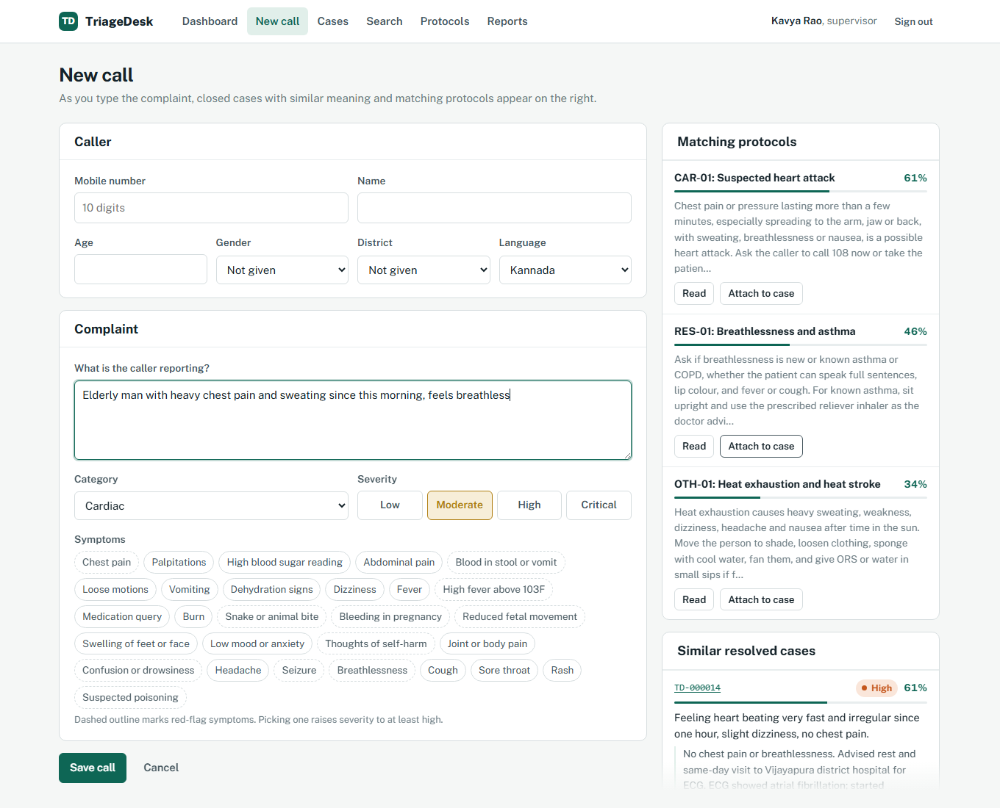
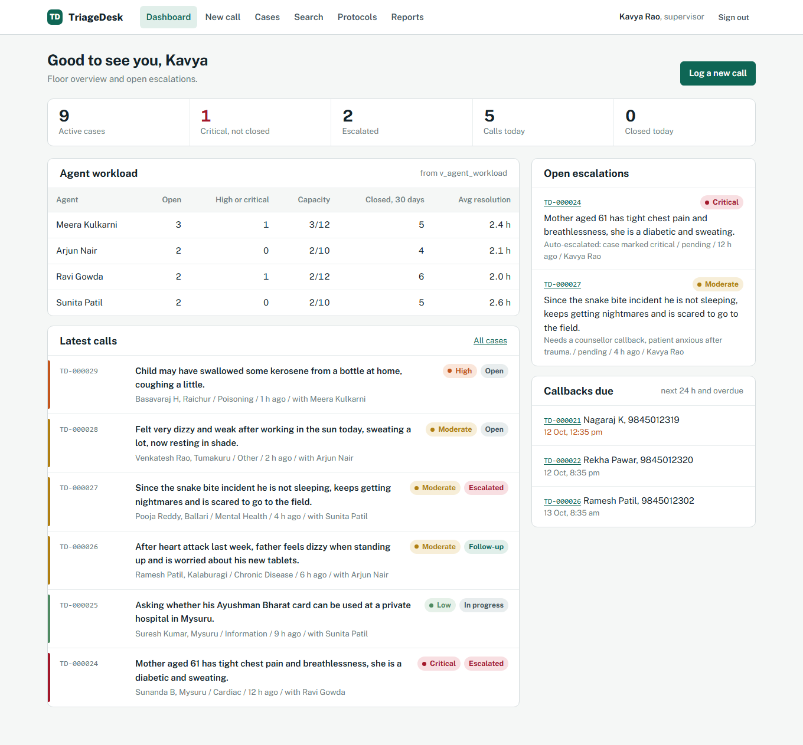
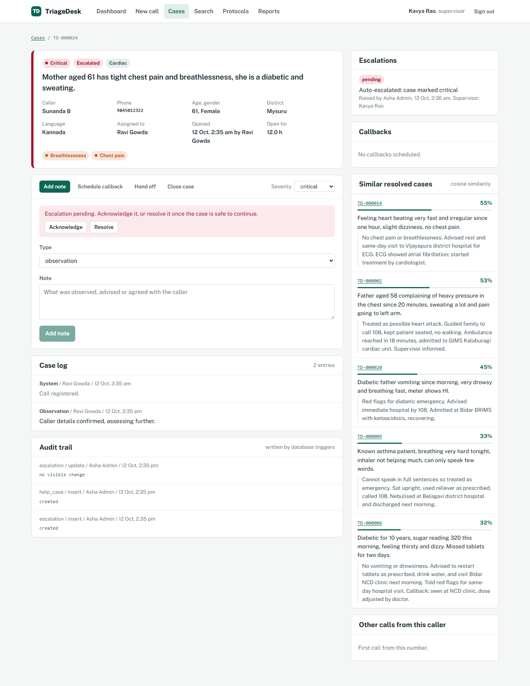
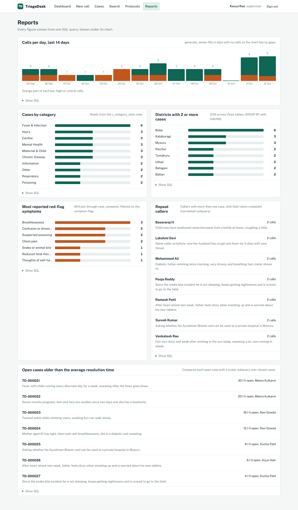
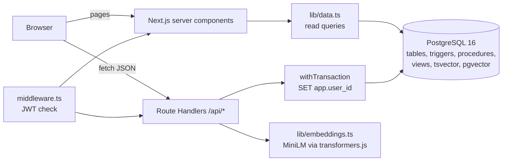
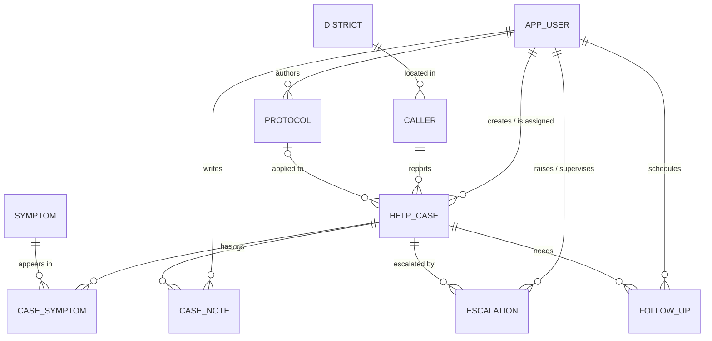

# TriageDesk

**Case logging and semantic case retrieval for health helplines.**

When a call comes in, the agent types the complaint and TriageDesk immediately shows resolved cases with a similar *meaning* and the protocol that fits. Keyword search fails on helplines because callers describe the same problem in different words ("baby is not kicking" vs "reduced fetal movement", "fits" vs "seizure"). TriageDesk keeps callers, cases, escalations and callbacks in PostgreSQL with strict integrity rules, and stores sentence embeddings of complaints and protocols in the same database through pgvector.

DBMS Experiential Learning, Level 3 mini project (PES University, Semester 5).

| | |
|---|---|
| **Stack** | Next.js 15 (App Router, Route Handlers), PostgreSQL 16, pgvector, transformers.js (all-MiniLM-L6-v2), bcrypt, JWT sessions, Zod |
| **Database features** | 11 tables in 3NF, ENUM and DOMAIN types, CHECK constraints, 9 triggers, 2 stored procedures, 3 views, B-tree / partial / functional / GIN / HNSW indexes, full-text search, vector similarity, JSONB audit log |
| **Docs** | [Design document](docs/DESIGN.md) (ER diagram, relational schema, data dictionary, justification) and [Testing](docs/TESTING.md) (30 test cases, which layer enforces each rule) |

## Screenshots

**New call.** As the agent types, matching protocols and similar resolved cases update on the right, ranked by cosine similarity.



**Dashboard.** Floor overview from the `v_agent_workload` view, open escalations and callbacks due.



**Case detail.** Actions for the assigned agent, case log, and the audit trail written by database triggers.



**Reports.** Every figure comes from one SQL query, shown under its chart.



## Features

- **Call registration** with caller lookup by mobile number, symptoms, category, severity and an optional protocol. One transaction covers the caller upsert, the case insert, auto-assignment and symptom links.
- **Live semantic matching** while typing: similar resolved cases and matching protocols from pgvector.
- **Safety rules in the database**, not only in the UI: a red-flag symptom raises severity to at least high, a critical case always escalates and gets a supervisor, a closed case cannot be reopened, a case cannot close without a resolution.
- **Case lifecycle**: notes, callbacks, escalation, handoff with capacity limits, closing. Handoff and close are stored procedures.
- **Search page** that runs keyword search (`tsvector`) and meaning search (vectors) side by side on the same query.
- **Protocol library** with re-embedding on save.
- **Reports** for supervisors: calls per day, categories, districts, red-flag symptoms, repeat callers, stale cases.
- **Roles**: agent, supervisor, admin. Deactivating an agent reassigns their open cases.
- **Audit trail** of every change to cases, escalations, users and protocols, stamped with the acting user.

## Architecture



**Request flow for "register a call".** The browser posts to `/api/cases`. The handler validates the body with Zod, computes the embedding *outside* the transaction so locks are held briefly, then in one transaction upserts the caller, inserts the case (calling `fn_pick_agent()` when the logger is a supervisor), links the symptoms and writes a system note. Inside that same transaction the database triggers raise severity for red flags, escalate critical cases and write the audit log. Any failure rolls everything back.

**How the database knows who made a change.** `withTransaction(actorId, fn)` in `src/lib/db.ts` calls `set_config('app.user_id', $1, true)` (transaction-local, same effect as `SET LOCAL`) at the start of every write transaction. The audit trigger reads it back with `current_setting('app.user_id', true)`, so `audit_log.changed_by` is filled in by the database and the application never writes the audit table directly.

**Security.** Passwords are bcrypt hashes and the column CHECK rejects anything that is not a bcrypt hash, so plaintext cannot be stored even by direct SQL. Sessions are HS256 JWTs in an httpOnly, SameSite cookie that expire after 8 hours. Every API handler re-checks the user's role and active status from the database. All SQL uses parameter placeholders. Credentials come only from environment variables.

## Data model



| Table | Purpose | Notable constraints |
|---|---|---|
| `app_user` | staff accounts | unique on `lower(email)`, bcrypt-format CHECK on `password_hash`, capacity 1 to 50 |
| `district`, `symptom` | lookup tables | `symptom.is_red_flag` drives the severity trigger |
| `caller` | people who call | `phone` CHAR(10) UNIQUE with Indian-mobile regex, `alt_phone` must differ |
| `help_case` | one call | ordered `case_severity` enum, `case_status` enum, resolution required when closed, `closed_at` set iff closed, `vector(384)` embedding, generated `tsvector` |
| `case_symptom` | M:N cases to symptoms | composite PK, cascade on case delete, restrict on symptom delete |
| `case_note` | timeline entries | `note_type` in observation / advice / follow_up / handoff / system |
| `escalation` | supervisor attention | partial unique index: at most one unresolved escalation per case |
| `follow_up` | callbacks | `scheduled_for` not in the past at creation, outcome required once completed |
| `protocol` | guidance documents | code format CHECK (`FEV-01`), content 50+ chars, `vector(384)` embedding |
| `audit_log` | history | JSONB before/after snapshots, no FKs so history survives deletions |

All tables are in 3NF. The full relational schema, normalisation notes and data dictionary are in [docs/DESIGN.md](docs/DESIGN.md).

## Database logic

| Kind | Name | What it does |
|---|---|---|
| Trigger | `t_red_flag_severity` | after a red-flag symptom is linked, raises the case to at least `high` |
| Trigger | `t_case_auto_escalate` | a critical case becomes `escalated` and gets an escalation row with `fn_pick_supervisor()` |
| Trigger | `t_case_lifecycle` | blocks reopening a closed case, stamps `closed_at`, requires resolution notes |
| Trigger | `t_case_touch`, `t_protocol_touch` | maintain `updated_at` |
| Trigger | `t_audit_case`, `t_audit_escalation`, `t_audit_user`, `t_audit_protocol` | write JSONB before/after rows to `audit_log` with the acting user |
| Procedure | `sp_close_case` | closes a case, stores the resolution, settles pending callbacks, writes a system note |
| Procedure | `sp_handoff_case` | moves a case to another agent after a capacity check and `SELECT ... FOR UPDATE` row lock |
| Function | `fn_pick_agent` | least-loaded active agent with spare capacity (`GROUP BY ... HAVING count < max_open_cases`) |
| Function | `fn_pick_supervisor` | supervisor with the fewest pending escalations |
| View | `v_case_overview` | five-table JOIN used by lists and reports |
| View | `v_agent_workload` | open / high-or-critical / closed-30-days / average resolution per agent, with `FILTER` aggregates |
| View | `v_category_stats` | counts per category |

Indexes: composite `(status, severity)`, partial `assigned_to WHERE status <> 'closed'`, functional `lower(email)`, partial unique on open escalations, GIN on `search_tsv`, HNSW (`vector_cosine_ops`) on both embedding columns. `db/99_important_queries.sql` has `EXPLAIN` plans that show each kind being used.

## Semantic search

- **Model:** `sentence-transformers/all-MiniLM-L6-v2` (ONNX build), run locally in Node with transformers.js. 384 dimensions, mean pooling, L2-normalised. No API key, and no health data leaves the machine.
- **What is embedded:** for cases, `category + chief_complaint + resolution_notes` (the resolution is added when the case closes, so a closed case becomes a better reference). For protocols, `title + category + content`.
- **Query:** embed the text, then `ORDER BY embedding <=> $1 LIMIT k`, keep rows above 0.25 similarity, and filter in the same SQL by status or category.
- **Why pgvector and not a separate vector database:** one transaction inserts a case and its embedding together, similarity queries JOIN caller and case data and filter by status in plain SQL, and there is no second system to keep in sync. At helpline scale (thousands of cases) a dedicated vector store would not pay for itself.
- **Refresh:** on case creation, on close, on protocol create or edit, and `npm run db:reembed` after a model change.

## API

All writes go through these endpoints. Every handler checks the session, then the role, then (for case actions) ownership of the case.

| Method | Path | Who | Does |
|---|---|---|---|
| POST | `/api/auth/login`, `/api/auth/logout` | anyone | bcrypt check, JWT cookie |
| GET | `/api/callers?phone=` | all | caller lookup with earlier cases |
| GET, POST | `/api/cases` | all | list with filters; register a call (one transaction) |
| GET, PATCH | `/api/cases/:id` | all / assigned agent or lead | detail; change status, severity, protocol |
| POST | `/api/cases/:id/notes`, `/escalate`, `/follow-ups`, `/handoff`, `/close` | assigned agent or lead | case actions; handoff and close call stored procedures |
| PATCH | `/api/escalations/:id` | supervisor, admin | acknowledge or resolve |
| PATCH, DELETE | `/api/follow-ups/:id` | assigned agent or lead | complete or cancel a callback |
| POST | `/api/search` | all | keyword and semantic results for one query |
| GET, POST | `/api/protocols` | all / supervisor, admin | list; create with embedding |
| PUT, DELETE | `/api/protocols/:id` | supervisor, admin / admin | edit (re-embeds); delete (cases keep history via `ON DELETE SET NULL`) |
| GET, POST | `/api/users` | admin | list; create |
| PATCH | `/api/users/:id` | admin | change role, capacity, active flag (reassigns open cases) |

Database errors are mapped to friendly messages in `src/lib/api.ts`, so a CHECK or UNIQUE violation reaches the user as "already exists" or "must be in the future" rather than a Postgres error code.

## Roles

| | Agent | Supervisor | Admin |
|---|---|---|---|
| Log calls, read every case | yes | yes | yes |
| Change a case (notes, callbacks, escalate, hand off, close) | only cases assigned to them | any case | any case |
| Acknowledge / resolve escalations | | yes | yes |
| Manage protocols | | create, edit | create, edit, delete |
| Reports and audit trail | | yes | yes |
| User management | | | yes |

## Setup

You need Node.js 20 or newer and Docker (or any PostgreSQL 16 with pgvector installed).

```bash
# 1. Install dependencies
npm install

# 2. Start Postgres + pgvector (port 5433)
docker compose up -d

# 3. Configure
cp .env.example .env
# then set AUTH_SECRET to a long random string:
node -e "console.log(require('crypto').randomBytes(48).toString('base64url'))"

# 4. Create the schema and load demo data
npm run db:migrate
npm run db:seed        # first run downloads the embedding model (~25 MB)

# 5. Run
npm run dev            # http://localhost:3000
```

`npm run db:reset` runs migrate and seed together and gives you a fresh database with 14 protocols and 29 cases.

### Demo accounts

All passwords are `Triage@123`.

| Role | Email |
|---|---|
| Admin | admin@triagedesk.in |
| Supervisor | supervisor@triagedesk.in, supervisor2@triagedesk.in |
| Agent | agent1@triagedesk.in to agent4@triagedesk.in |

## Tests

`scripts/api-smoke-test.sh` signs in as an agent, a supervisor and an admin, drives the REST API with `curl`, and checks the database directly with `psql` where a rule lives in the database (for example inserting a plaintext password, or closing a case without a resolution, straight in SQL). 30 checks, all passing. The full table of cases and the layer that enforces each one is in [docs/TESTING.md](docs/TESTING.md).

```bash
npm run db:reset
npm run dev                                   # in another terminal
BASE_URL=http://localhost:3000 bash scripts/api-smoke-test.sh
```

The script needs `psql` on your PATH. If you only have the Docker container, run it through `docker exec -i triagedesk-db psql -U triagedesk -d triagedesk`.

## Project layout

```
db/
  01_schema.sql            DDL: types, domain, tables, constraints, ALTERs, indexes
  02_programmability.sql   functions, triggers, stored procedures, views
  03_reference_data.sql    districts and symptoms
  99_important_queries.sql queries to run live (EXPLAIN plans, rolled-back trigger demo)
scripts/
  migrate.ts               applies db/0*.sql in one transaction
  seed.ts                  users (bcrypt), protocols and cases (with embeddings)
  reembed.ts               recomputes all vectors after a model change
  api-smoke-test.sh        30 end-to-end checks
src/
  middleware.ts            redirects signed-out users, blocks wrong roles
  lib/db.ts                connection pool, withTransaction (sets app.user_id)
  lib/embeddings.ts        embedding model, vector formatting
  lib/search.ts            semantic (pgvector) and keyword (full-text) search
  lib/data.ts              read queries used by pages
  lib/reports.ts           report queries (shown on the Reports page)
  lib/api.ts               auth checks, DB error to friendly message mapping
  lib/validation.ts        Zod schemas (the DB constraints are the final guard)
  app/api/**               REST endpoints (all writes go through here)
  app/(app)/**             pages
docs/
  DESIGN.md                problem, objectives, ER diagram, schema, data dictionary, justification
  TESTING.md               test cases and results
  screenshots/
```

## Notes

- Never commit `.env`. Credentials are read from environment variables only.
- `EMBEDDING_PROVIDER=hash` is an offline fallback for running without the model. Similarity quality is poor with it; use `local` (the default) for the demo. If you switch, run `npm run db:reembed`.
- Complaints are typed in English. A multilingual embedding model for Kannada and Hindi is listed under future work in the design document.

## Licence

MIT. See [LICENSE](LICENSE).
