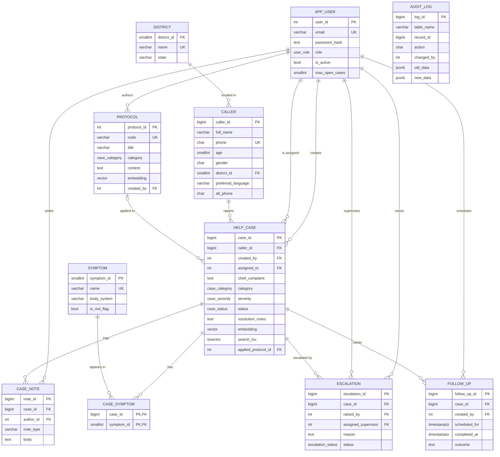
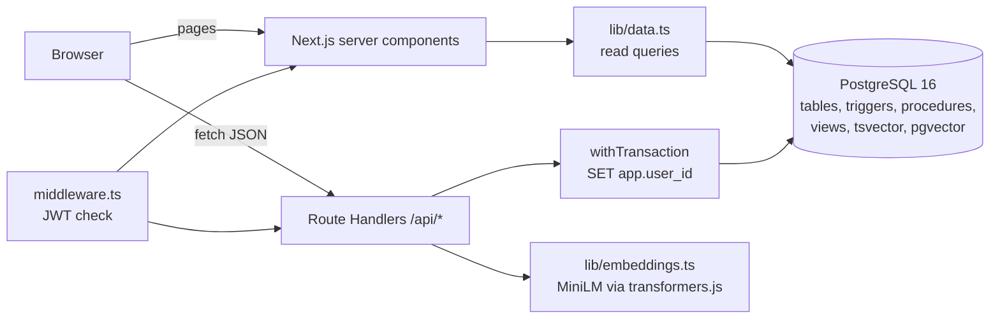

# TriageDesk: Design Document

## 1. Problem statement

Public health helplines such as 104 receive thousands of calls a day about fever, pregnancy danger signs, poisoning, chest pain and mental distress. Agents rotate across shifts, and the knowledge of how a similar call was handled last week sits inside free-text notes that nobody can find again. Keyword search fails here because callers describe the same problem in different words ("baby is not kicking" vs "reduced fetal movement", "fits" vs "seizure").

TriageDesk is a case management system for such a helpline. It keeps callers, cases, symptoms, escalations and callbacks in a relational database with strict integrity rules, and adds semantic retrieval so that a new complaint immediately surfaces resolved cases and protocols with a similar meaning.

## 2. Objectives

1. Model helpline operations (callers, cases, symptoms, notes, escalations, callbacks, protocols, staff) in a normalised relational schema with integrity enforced in the database.
2. Encode safety rules as database logic: red-flag symptoms raise severity, critical cases always escalate, closed cases cannot be reopened, and every change is audited.
3. Retrieve similar past cases and relevant protocols by meaning using vector embeddings stored in PostgreSQL (pgvector).
4. Provide a role-based web interface (agent, supervisor, admin) built with Next.js.
5. Give supervisors operational reports built from aggregate SQL.

## 3. Scope

**In scope:** call registration with caller lookup, case lifecycle (open, in progress, escalated, follow-up, closed), notes, escalations, callbacks, case handoff with capacity limits, protocol library, semantic and keyword search, reports, user management, audit trail.

**Out of scope:** telephony integration, SMS, multilingual embeddings (complaints are typed in English), patient medical records beyond the call, production deployment.

## 4. Functional requirements

| ID | Requirement | Role |
|---|---|---|
| FR1 | Sign in with email and password; sessions expire after 8 hours | All |
| FR2 | Look up a caller by mobile number and see their earlier cases | All |
| FR3 | Register a call: caller details, complaint, category, severity, symptoms, optional protocol | All |
| FR4 | While typing a complaint, show similar resolved cases and matching protocols | All |
| FR5 | Auto-assign a new case to the least-loaded agent with spare capacity (when logged by a lead) | System |
| FR6 | Raise severity to at least high when a red-flag symptom is recorded | System |
| FR7 | Escalate critical cases automatically and assign a supervisor | System |
| FR8 | Add notes, schedule and complete callbacks, escalate, hand off and close cases | Assigned agent, leads |
| FR9 | Acknowledge and resolve escalations | Supervisor, admin |
| FR10 | Search cases by keywords (full-text) and by meaning (vectors), side by side | All |
| FR11 | Create, edit, retire protocols (re-embedded on save); delete protocols | Supervisor, admin / admin |
| FR12 | View reports: daily volume, categories, districts, red-flag symptoms, repeat callers, stale cases | Supervisor, admin |
| FR13 | Create users, change roles and capacity, deactivate users (their cases are reassigned) | Admin |
| FR14 | View the audit trail of a case | Supervisor, admin |

## 5. ER diagram

**Cardinalities worth stating in the viva**

- A caller can have many cases; each case belongs to exactly one caller (total participation of HELP_CASE).
- CASE and SYMPTOM are many-to-many, resolved by CASE_SYMPTOM with a composite primary key.
- A case may have many escalations over time, but at most one unresolved escalation at a time (partial unique index).
- PROTOCOL to HELP_CASE is optional on both sides (a case may follow no protocol).
- AUDIT_LOG deliberately has no foreign keys so history survives deletions.

## 6. Relational schema

Underline = primary key, `*` = foreign key.

- APP_USER(<u>user_id</u>, full_name, email, password_hash, role, is_active, max_open_cases, created_at, last_login_at)
- DISTRICT(<u>district_id</u>, name, state)
- CALLER(<u>caller_id</u>, full_name, phone, age, gender, district_id\*, preferred_language, created_at, alt_phone)
- SYMPTOM(<u>symptom_id</u>, name, body_system, is_red_flag)
- PROTOCOL(<u>protocol_id</u>, code, title, category, content, embedding, is_active, created_by\*, created_at, updated_at)
- HELP_CASE(<u>case_id</u>, caller_id\*, created_by\*, assigned_to\*, chief_complaint, category, severity, status, resolution_notes, opened_at, updated_at, closed_at, embedding, search_tsv, applied_protocol_id\*)
- CASE_SYMPTOM(<u>case_id\*, symptom_id\*</u>)
- CASE_NOTE(<u>note_id</u>, case_id\*, author_id\*, note_type, body, created_at)
- ESCALATION(<u>escalation_id</u>, case_id\*, raised_by\*, assigned_supervisor\*, reason, status, created_at, resolved_at)
- FOLLOW_UP(<u>follow_up_id</u>, case_id\*, created_by\*, scheduled_for, completed_at, outcome, created_at)
- AUDIT_LOG(<u>log_id</u>, table_name, record_id, action, changed_by, old_data, new_data, changed_at)

**Normalisation.** Every table is in 3NF. District names were moved out of CALLER into DISTRICT to avoid a transitive dependency (caller to district name to state). Symptoms are a lookup table instead of a free-text list, which makes the M:N relationship and the red-flag rule possible. `search_tsv` is a stored generated column; it is derived data kept by Postgres itself, so it cannot drift from the source columns. `embedding` is also derived, kept for performance and refreshed by the application whenever its source text changes.

## 7. Data dictionary

### app_user
| Column | Type | Constraints | Meaning |
|---|---|---|---|
| user_id | INT identity | PK | |
| full_name | VARCHAR(100) | NOT NULL, at least 2 chars | |
| email | VARCHAR(150) | NOT NULL, regex CHECK, unique on lower(email) | login id |
| password_hash | TEXT | NOT NULL, CHECK matches bcrypt format | plaintext is impossible to store |
| role | user_role enum | agent / supervisor / admin | |
| is_active | BOOLEAN | default TRUE | deactivated users cannot sign in |
| max_open_cases | SMALLINT | 1 to 50 | capacity used by auto-assignment |
| created_at, last_login_at | TIMESTAMPTZ | | |

### caller
| Column | Type | Constraints | Meaning |
|---|---|---|---|
| caller_id | BIGINT identity | PK | |
| full_name | VARCHAR(100) | NOT NULL, at least 2 chars | |
| phone | CHAR(10) | UNIQUE, CHECK `^[6-9][0-9]{9}$` | Indian mobile, used as natural lookup key |
| age | SMALLINT | 0 to 120 | |
| gender | CHAR(1) | M / F / O | |
| district_id | SMALLINT | FK district, ON DELETE SET NULL | |
| preferred_language | VARCHAR(20) | CHECK list | |
| alt_phone | CHAR(10) | valid mobile, different from phone (added by ALTER) | |

### help_case
| Column | Type | Constraints | Meaning |
|---|---|---|---|
| case_id | BIGINT identity | PK | shown as TD-000123 |
| caller_id | BIGINT | FK caller, ON DELETE RESTRICT | a caller with cases cannot be deleted |
| created_by / assigned_to | INT | FK app_user | |
| chief_complaint | TEXT | at least 10 chars | |
| category | case_category domain | 10 allowed values | shared with protocol |
| severity | case_severity enum | low < moderate < high < critical | ordered, so `severity >= 'high'` works |
| status | case_status enum | open, in_progress, escalated, follow_up, closed | |
| resolution_notes | TEXT | required (10+ chars) when closed | |
| opened_at / updated_at / closed_at | TIMESTAMPTZ | closed_at set iff closed, closed_at >= opened_at | |
| embedding | vector(384) | HNSW index | complaint (+ resolution) embedding |
| search_tsv | tsvector | generated, GIN index | complaint weight A, resolution weight B |
| applied_protocol_id | INT | FK protocol, ON DELETE SET NULL (added by ALTER) | |

### Other tables (summary)
- **district:** name UNIQUE, state default Karnataka.
- **symptom:** name UNIQUE, `is_red_flag` drives trigger T4.
- **protocol:** code UNIQUE with format CHECK (`FEV-01`), content at least 50 chars, `embedding vector(384)`.
- **case_symptom:** composite PK; deleting a case cascades, deleting a used symptom is blocked.
- **case_note:** `note_type` in observation / advice / follow_up / handoff / system.
- **escalation:** `resolved_at` set iff status = resolved; partial unique index allows one unresolved escalation per case.
- **follow_up:** `scheduled_for` must not be in the past at creation; `outcome` required once completed.
- **audit_log:** JSONB snapshots before and after, `changed_by` taken from the transaction setting `app.user_id`.

## 8. Database choice and justification

| Data | Nature | Stored as | Why |
|---|---|---|---|
| Users, callers, cases, escalations, callbacks | Structured, relational, needs integrity and transactions | PostgreSQL tables | Foreign keys, CHECKs and ACID transactions are essential: a case must never point to a missing caller, a closed case must have a resolution, a handoff must not overload an agent. |
| Complaint and resolution text | Unstructured, phrased differently by every caller | `tsvector` (keyword) and `vector(384)` (meaning) | Full-text search finds exact terms fast; embeddings find the same situation described in other words. We keep both and compare them on the Search page. |
| Protocols | Semi-structured documents read by meaning | Table + `vector(384)` | Agents need "the protocol for this situation", not "protocols containing word X". |
| Audit history | Variable shape per table | JSONB | Each audited table has different columns; JSONB stores any row shape without a separate history table per entity. |

**Why pgvector instead of a separate vector database.** Option 2 of the brief allows "PostgreSQL with pgvector". Keeping vectors next to the rows they describe means one transaction can insert a case and its embedding together, similarity queries can JOIN with caller and case data and filter by status or category in the same SQL, and there is no second system to keep in sync. The data size (thousands of cases) is far below where a dedicated vector store would pay off.

## 9. Vector search details

- **What is embedded:** for cases, `category + chief_complaint + resolution_notes` (the resolution is added when the case closes, so the closed case becomes a better reference). For protocols, `title + category + content`.
- **Model:** `sentence-transformers/all-MiniLM-L6-v2` (ONNX build `Xenova/all-MiniLM-L6-v2`), run locally in Node with transformers.js. 384 dimensions, mean pooling, L2-normalised. No API key and no data leaves the machine, which matters for health data.
- **Storage:** `vector(384)` columns on `help_case` and `protocol`.
- **Index:** HNSW with `vector_cosine_ops`, an approximate nearest neighbour graph index, so queries do not scan every row as the table grows.
- **Metric:** cosine distance via the `<=>` operator. Similarity shown to users is `1 - distance`.
- **Retrieval:** embed the query text, `ORDER BY embedding <=> $query LIMIT k`, keep results above a minimum similarity (0.25), and filter in SQL by status (resolved only on the intake screen) and optionally category.
- **When vectors are refreshed:** on case creation, on case close (resolution added), on protocol create and edit, and by `npm run db:reembed` after a model change.

## 10. Advanced database features used

| Feature | Where |
|---|---|
| Triggers (5) | `t_case_touch`, `t_case_lifecycle`, `t_case_auto_escalate`, `t_red_flag_severity`, `t_audit_*` |
| Stored procedures (2) | `sp_close_case`, `sp_handoff_case` (called with `CALL` from the API) |
| Functions | `fn_pick_agent`, `fn_pick_supervisor`, `fn_current_app_user` |
| Views (3) | `v_case_overview`, `v_agent_workload`, `v_category_stats` |
| Transactions | every write in `withTransaction()`; row locks with `SELECT ... FOR UPDATE` |
| Indexing | B-tree, composite, partial, functional (`lower(email)`), GIN, HNSW |
| Full-text search | generated `tsvector`, `websearch_to_tsquery`, `ts_rank`, `ts_headline` |
| Vector similarity | pgvector `<=>`, HNSW |
| Others | ENUM types, DOMAIN, generated column, JSONB, `generate_series`, `FILTER` aggregates |

## 11. Important queries

See `db/99_important_queries.sql` for runnable versions. Highlights:

- **Least-loaded agent** (`fn_pick_agent`): LEFT JOIN users to open cases, `GROUP BY` user, `HAVING count < max_open_cases`, `ORDER BY count`.
- **Similar resolved cases**: `ORDER BY h.embedding <=> src.embedding` with a `CROSS JOIN` to the source case's vector.
- **Repeat callers**: `GROUP BY caller HAVING count(*) > 1` with a correlated subquery for the latest complaint.
- **Stale cases**: open cases whose age exceeds a scalar subquery over the average resolution time.
- **Calls per day**: `generate_series` LEFT JOINed to cases so empty days still show.

## 12. System architecture

**Request flow for "register a call":** the browser posts to `/api/cases`; the handler validates input with Zod, computes the embedding outside the transaction, then in one transaction upserts the caller, inserts the case (with `fn_pick_agent()` when needed), links symptoms and writes a system note. Inside that same transaction the database triggers raise severity for red flags, escalate critical cases and write the audit log. Any failure rolls everything back.

**Security:** passwords hashed with bcrypt (cost 12 for new users) and the column CHECK rejects anything that is not a bcrypt hash; sessions are HS256 JWTs in an httpOnly, SameSite cookie; every API handler re-checks the user's role and active status from the database; all SQL uses parameter placeholders; credentials only come from environment variables.

## 13. Conclusion and future enhancements

TriageDesk shows how a relational core and vector retrieval complement each other: constraints, triggers and transactions keep the operational data correct, while embeddings make years of resolved calls useful to the next agent.

Possible next steps: a multilingual embedding model so Kannada and Hindi complaints can be searched directly; hybrid ranking that blends `ts_rank` with cosine similarity; row-level security policies instead of application checks; a materialised view for reports refreshed on a schedule; and SMS reminders for callbacks.

## Appendix: application screenshots

Screenshots below were taken with the real model (`EMBEDDING_PROVIDER=local`, all-MiniLM-L6-v2) on the seeded demo data. Similarity percentages are `1 - cosine distance`.

